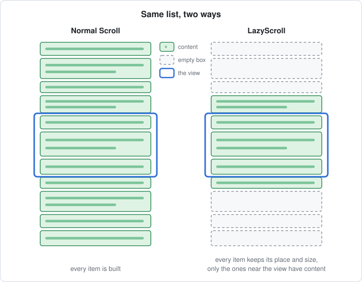
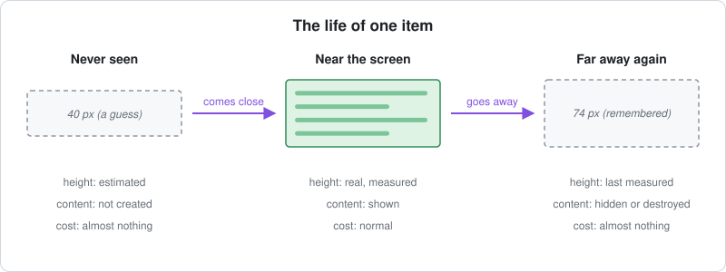
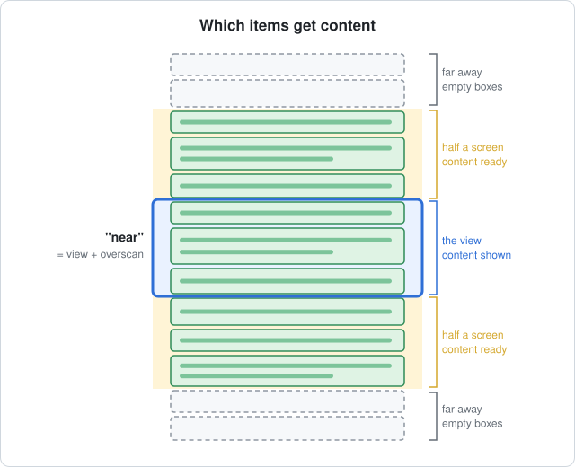
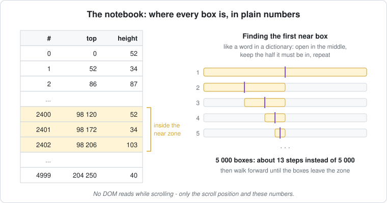
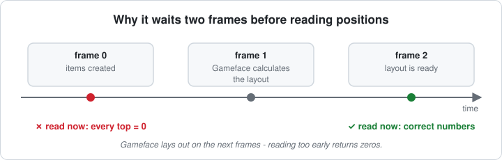
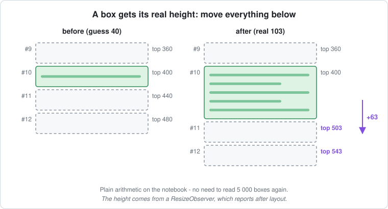
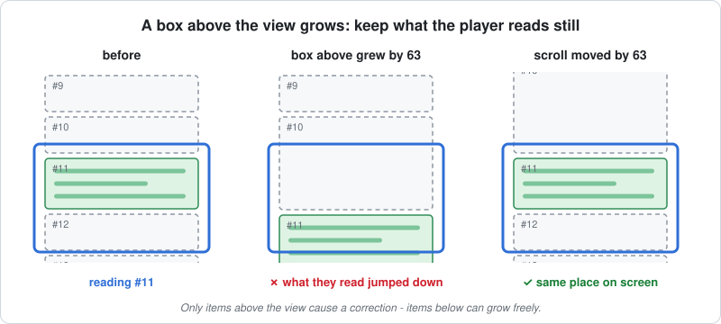
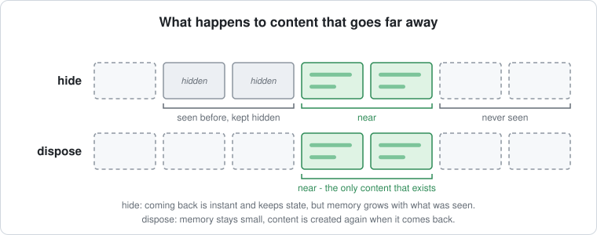

# LazyScroll — how it works

An **experiment** (`LazyScroll.tsx` in this folder): a scroll that takes any children of any height, like
a normal `Scroll`, but only gives content to the items near the view.

← Back to the overview: [Long lists in Gameface UI](./README.md)

**Contents:**
[1. Boxes](#1-every-item-is-a-box) ·
[2. Life of an item](#2-the-life-of-one-item) ·
[3. Near](#3-what-near-means) ·
[4. The notebook](#4-finding-near-boxes-without-asking-the-dom) ·
[5. Keeping it right](#5-keeping-the-notebook-right) ·
[6. Hide or dispose](#6-hide-or-dispose) ·
[7. Bugs found](#7-two-bugs-found-while-building-it) ·
[8. Measured](#8-measured) ·
[9. Limits](#9-limits) ·
[10. Try it](#10-trying-it)

---

## In short

- Every child is wrapped in a **box** (`LazyScroll.Item`) that always keeps its place and size.
- Only boxes **near the view** have content. Far away they are empty boxes with a remembered height.
- Boxes are in **normal flow**, so the layout places them — items can have **any height**.
- While scrolling it only uses the scroll position and a **cached list of box positions** — no DOM reads.
- Unlike `VirtualScroll`, there is still **one element per item** (an empty box), so it's meant for
  hundreds to a few thousand items.
- Result: **60 FPS** with 5 000 items of any height, where the normal Scroll runs at 25
  ([measurements](#8-measured)).

---

## 1. Every item is a box

**The box always keeps its place and size. Its content is only unpacked near the view.**

```tsx
<LazyScroll style={{ height: '60vh' }}>
    <For each={messages()}>
        {(message) => (
            <LazyScroll.Item>            {/* the box - always there       */}
                <ChatMessage ... />      {/* the content - only when near */}
            </LazyScroll.Item>
        )}
    </For>
</LazyScroll>
```



- Think of a bookshelf with labelled boxes: every box is on the shelf, you only open the ones in front
  of you, and closing a box doesn't move anything.
- The content is only created when needed — Solid builds children lazily, so a box that was never near
  the view costs one empty element.
- Every child **must** be wrapped. Plain children would be built by Solid before LazyScroll could hold
  them back.

---

## 2. The life of one item

**Never seen → near the view → far away again.**



| State | Height | Content |
| --- | --- | --- |
| Never seen | estimated (40 px by default, `estimatedHeight`) | not created |
| Near the view | whatever the content needs — measured | shown |
| Far away again | the last measured height, fixed | hidden or destroyed ([section 6](#6-hide-or-dispose)) |

---

## 3. What "near" means

**The view, plus half a screen above and below.**



- The extra half screen (*overscan*, `overscan` prop) gets content before it scrolls in, so the player
  never sees an empty box.

---

## 4. Finding near boxes without asking the DOM

**A cached "notebook" of every box's top and height, searched like a dictionary.**



On every scroll:

1. Near zone = `scrollTop − overscan` … `scrollTop + view + overscan`.
2. **Binary search** for the first box in the zone — about 13 steps for 5 000 boxes.
3. Walk forward until the boxes leave the zone.
4. Boxes that **entered** get content, boxes that **left** lose it; the rest aren't touched.

Why not just read each box's position? Every DOM read goes into the engine and is much slower than
reading a number — 5 000 reads per frame would bring back the cost we're removing.

---

## 5. Keeping the notebook right

**The notebook is filled from the DOM only in three situations — never while just scrolling.**

### 5a. Full read — items added / removed, or the width changed

**It waits until Gameface has laid things out.**



- Gameface lays out a frame or two after a change; reading earlier gives zeros.
- If the list still has no size after 2 frames (big lists take longer), it tries again every frame.
- The width matters because text wraps differently, so heights change.

### 5b. A box gets its real height — move everything below

**Plain arithmetic instead of reading 5 000 boxes again.**



- Heights come from a `ResizeObserver`, which reports **after** layout. Only near boxes are watched.
- Assumes one box per row (a list). Grid cells in the bench have a fixed size, so they never shift.

### 5c. A box above the view grows — keep the view still

**The scroll moves by the same amount, so what the player reads doesn't jump.**



- Only boxes **above** the view cause a correction; boxes below can grow freely.

---

## 6. Hide or dispose?

**What happens to content that goes far away (`mode`).**



| | `hide` | `dispose` |
| --- | --- | --- |
| Far-away content | kept, hidden (`display: none`) | destroyed |
| Coming back | instant, state kept (open panels, typed text, scroll inside) | built again, state lost |
| Memory and elements | grow with everything seen | stay small: one empty box per item + a screenful of content |
| Use for | content that is expensive to build or holds state | very long lists scrolled far |

---

## 7. Two bugs found while building it

| Bug | Cause | Fix |
| --- | --- | --- |
| **Boxes grew to 60 000 000 000 000 px** | The content had `height: 100%` inside a box whose height comes from its content. Gameface resolved it against the whole scroll, and every measurement made the next one bigger. | Filling the box is opt-in (`fill`), only for boxes with a fixed size (list rows, grid cells). |
| **Every item became "near"** | The first full read ran before layout, so every box said `top = 0` — all 5 000 got content. | Wait until the list has a size; retry until it does. |

---

## 8. Measured

**LazyScroll holds 60 FPS where the normal Scroll drops to 25.** It does more work than VirtualScroll, but
handles items of any height.

Gameface Player on the local machine (60 FPS), fresh instance, 5 000 items, 5 s per mode, 3 rounds, all in
one run. Full tables for every mode: [overview → Measured](./README.md#5-measured).

| Layout | | FPS | Slowest 5 % | Script per frame | Elements | Time to open |
| --- | --- | --- | --- | --- | --- | --- |
| Grid, fast scroll | Normal Scroll | 25.5 | 44.7 ms | – | 40 007 | 144 ms |
| | VirtualScroll `recycle` | 59.3 | 17.1 ms | 0.51 ms | 624 | 3 ms |
| | **LazyScroll `hide`** | **60.0** | **17.6 ms** | 0.89 ms | 40 830 | 73 ms |
| | **LazyScroll `dispose`** | **59.3** | **18.7 ms** | 0.90 ms | 5 681 | 94 ms |
| List, fast scroll | Normal Scroll | 24.9 | 45.6 ms | – | 40 007 | 152 ms |
| | VirtualScroll `recycle` | 59.2 | 17.0 ms | 0.25 ms | 160 | 3 ms |
| | **LazyScroll `hide`** | **59.9** | **17.3 ms** | 0.42 ms | 16 286 | 73 ms |
| | **LazyScroll `dispose`** | **59.7** | **17.3 ms** | 0.44 ms | 5 217 | 60 ms |
| Chat, fast / normal scroll | Normal Scroll | 52.9 / 52.8 | 23.6 ms | – | 15 007 | 86 – 90 ms |
| | **LazyScroll `hide`** | **59.1 / 60.0** | **17.3 ms** | 0.16 – 0.23 ms | 5 794 – 8 028 | 58 – 63 ms |
| | **LazyScroll `dispose`** | **58.6 / 60.0** | **17.5 ms** | 0.15 – 0.27 ms | 5 065 | 50 – 52 ms |

- **60 FPS in every layout** — grid, list and chat.
- **Hidden content costs nothing per frame.** `hide` had 40 830 elements in the grid — more than the
  normal Scroll — and still ran at 60 FPS, because almost all of them were `display: none`.
- **More work than VirtualScroll:** ~1.7× the script time of `recycle`, and 50 – 95 ms to open (every box
  is built and measured once) against 3 ms.
- **`dispose` has rare spikes** (worst frame 102 ms in the grid) when many boxes get content at the same
  time; `hide` stayed below 34 ms.
- The chat is lighter than the cards (15 000 elements), so even the normal Scroll reaches 53 FPS there —
  LazyScroll still brings it to 60 and removes the 24 ms frames.

---

## 9. Limits

The full list of risks, with fixes, is in the overview: [Risks](./README.md#4-risks). Specific to LazyScroll:

- **One element per item stays** — great for hundreds or a few thousand items; for tens of thousands use
  VirtualScroll.
- **Guessed heights** — dragging far lands roughly in the right place; the scrollbar adjusts a little as
  real heights are measured.
- **Late measurements** — during very fast scrolling a new item can show at its guessed height for a frame.
- **Lists only** — shifting heights assumes one box per row.
- **Every child must be wrapped** in `LazyScroll.Item`.
- **`hide` keeps everything it has shown** — FPS stays at 60, but memory grows. **`dispose`** restarts
  animations, loses state and can spike when many boxes fill at once.
- **Opening costs 50 – 95 ms** for 5 000 items — every box is built and measured once.

---

## 10. Trying it

1. Run the dev server and open `/virtual-scroll-bench/` in the Gameface Player.
2. Pick a **Layout**: `list`, `grid` or `chat` (messages of different heights).
3. Click a **Live** mode (`lazy-hide`, `lazy-dispose`, `plain`, `recycle`) and watch the FPS — or
   **Run benchmark** for the full table.

| File | What's in it |
| --- | --- |
| `LazyScroll.tsx` | The experiment: `LazyScroll` and `LazyScroll.Item` |
| `VirtualScrollBench.tsx` | The bench, with the `lazy-hide` / `lazy-dispose` modes and the `chat` layout |
| `VirtualScrollBench.module.scss` | Styles (`.lazyRoot`, `.lazyContent`, `.lazyContentFill`, chat messages) |
| `lazy-scroll-images/` | The pictures in this document |
