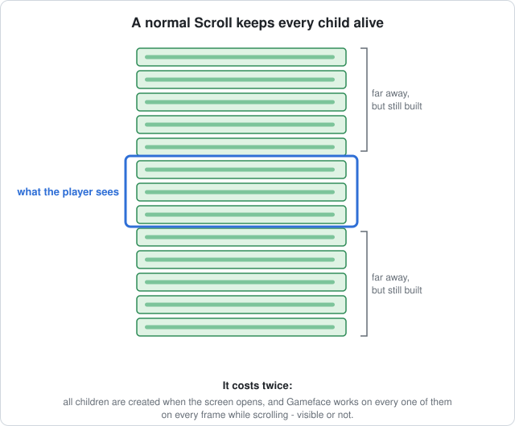
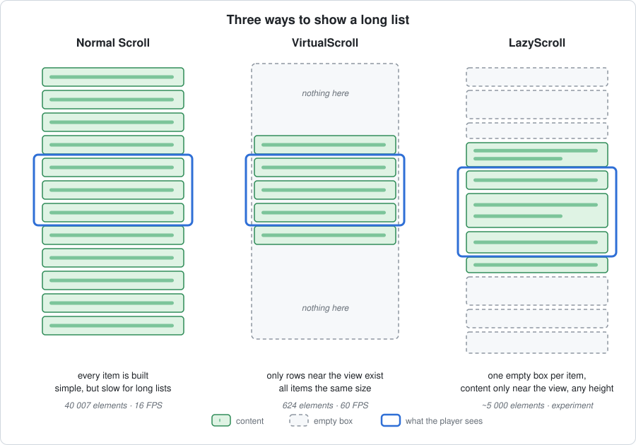
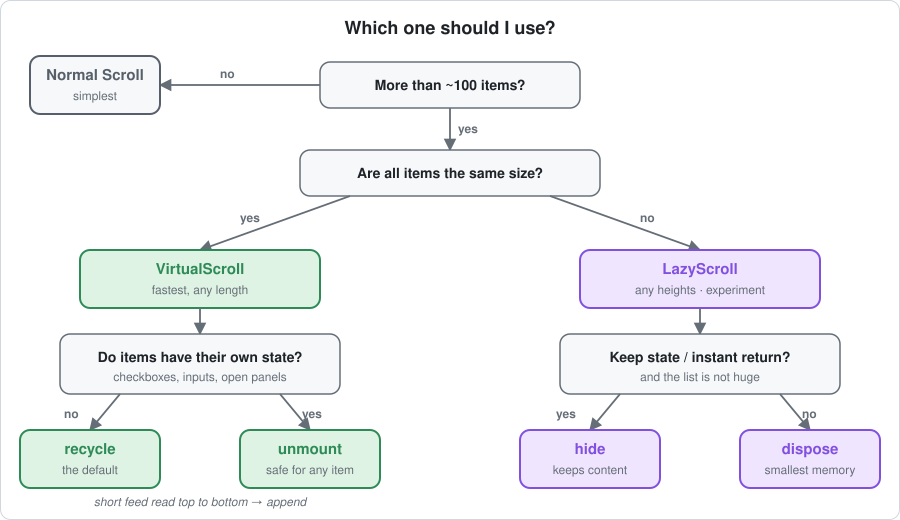
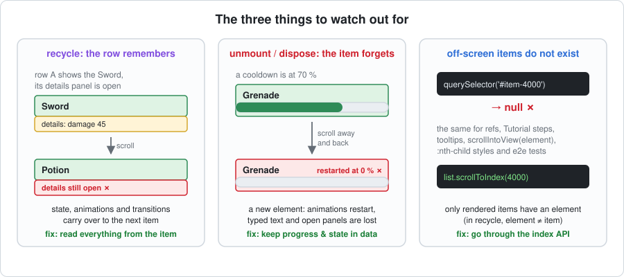

# Long lists in Gameface UI

How to show long lists and grids — leaderboards, inventories, chats — without slowing the UI down.

**Read this first.** It explains the problem, the two solutions and when to use which.
The details are in two separate documents:

- [VirtualScroll — how it works](./VirtualScroll.md) — the component, for items of the same size.
- [LazyScroll — how it works](./LazyScroll.md) — an experiment, for items of different sizes.

---

## At a glance

| | Normal `Scroll` | `VirtualScroll` | `LazyScroll` |
| --- | --- | --- | --- |
| **Idea** | every item is built | only the rows near the view exist | every item is an empty box; content only near the view |
| **Item sizes** | any | all the same | any |
| **Speed with 5 000 items** | 16 – 26 FPS, 0.15 – 0.4 s to open | 60 FPS, 3 ms to open | 60 FPS, 50 – 95 ms to open |
| **Status** | in the library | in the library | experiment in this folder |

---

## 1. The problem

**A normal `Scroll` builds every item, even the ones the player can't see.**

It costs twice:

- **When the screen opens** — every item is created. 5 000 inventory cards take 0.3 – 0.4 s.
- **On every frame while scrolling** — Gameface works on every element in the scrolled area, visible or
  not. 5 000 cards (~40 000 elements) scroll at 16 – 26 FPS.

**The fix is to have fewer elements in the scrolled area.**

---

## 2. Three ways to show a long list

| | How it keeps the element count low |
| --- | --- |
| **Normal Scroll** | It doesn't — fine for short lists. |
| **VirtualScroll** | A tall empty spacer gives the scrollbar its size. Only the rows around the view are real; when you scroll, they move and show other items. Needs every item to be the same size, because positions are calculated. [How VirtualScroll works →](./VirtualScroll.md) |
| **LazyScroll** | Every item is a box that keeps its place and size. Only boxes near the view have content; far away they are empty. Sizes can differ, because the layout places the boxes. [How LazyScroll works →](./LazyScroll.md) |

---

## 3. Which one should I use?

### Examples

| Screen | Use | Why |
| --- | --- | --- |
| Main / pause menu, tabs, a settings page with ~30 options | **Normal Scroll** | Short — nothing to gain. |
| Credits, a long text, a rules page | **Normal Scroll** | One long block of text, not many items. |
| Leaderboard with thousands of players | **VirtualScroll** · `recycle` | Same-size rows, can be very long. |
| Inventory, stash, shop catalogue | **VirtualScroll** · `recycle` + `itemWidth` | Same-size grid cells. Columns follow the screen width. |
| Achievements, match history (fixed rows) | **VirtualScroll** · `recycle` | Rows only show data. |
| Server browser that loads pages | **VirtualScroll** · `recycle` + `onEndReached` | Loads more as you reach the end. |
| Kill feed with one-line entries | **VirtualScroll** · `recycle` + `stickToEnd` | Grows at the bottom, stays at the bottom. |
| Friends list with a toggle or checkbox per row | **VirtualScroll** · `unmount` | Rows contain components that keep their own state. |
| Short notification feed read once from top to bottom | **VirtualScroll** · `append` | Opens fast; going back up is free. |
| Chat with messages of 1 – 6 lines | **LazyScroll** · `dispose` | Different heights, can get very long. |
| Quest log, mail inbox, patch notes with expandable entries | **LazyScroll** · `hide` | Different heights; open entries stay open. |

### Stay with the normal Scroll when

- The list has **fewer than ~100 items** — virtualizing adds complexity for no visible gain.
- The content is **one long thing** (a text, a single big layout) and not many similar items.
- You need things that only work when **every item exists** — `:nth-child` styles, `Tutorial` steps or
  tooltips pointing at any item, `querySelector` / refs to any item, e2e tests that find any item.
- Items **animate on their own** all the time and must never restart or carry over (see [risks](#4-risks)).

---

## 4. Risks

**Virtual and lazy lists are fast because they forget what's off-screen.** Anything that relies on an
element existing, staying in one place or remembering something by itself is a risk.

### Per mode

✓ works like a normal Scroll · ⚠ works, with a catch · ✗ doesn't work

| | VirtualScroll `recycle` | VirtualScroll `unmount` | VirtualScroll `append` | LazyScroll `hide` | LazyScroll `dispose` |
| --- | --- | --- | --- | --- | --- |
| Animations when an item comes back | ⚠ don't restart; transitions fire between items | restart | ✓ | restart *(likely)* | restart |
| State inside an item (open panel, typed text) | ⚠ carries over to other items | lost | ✓ | ✓ | lost |
| Off-screen elements, refs, `querySelector` | ✗ | ✗ | ✗ beyond what is loaded | ✓ seen / ✗ never seen | ✗ |
| `:nth-child`, odd / even striping | ✗ | ✗ | ✓ | ✓ | ✓ |
| Items of different sizes | ✗ | ✗ | ✗ | ✓ | ✓ |
| Popups that reach into the next row | ⚠ can be covered | ⚠ can be covered | ⚠ can be covered | ✓ | ✓ |
| Images while scrolling | ⚠ old icon until the new loads | ⚠ loads again | ✓ | ✓ | ⚠ loads again |
| Exact scrollbar | ✓ | ✓ | ✓ | ⚠ estimated until seen | ⚠ estimated until seen |
| Gets slower the longer you scroll | no | no | **yes** | no — but memory grows | no |

### The details, and how to avoid them

| Risk | What happens | How to avoid it |
| --- | --- | --- |
| **Animations** | `recycle` reuses elements — animations don't restart, and transitions animate from the previous item to the next. `unmount` / `dispose` create new elements — animations start from 0 again. | Drive long animations (cooldowns, progress) from data, e.g. a start time. Restart appear-animations when `props.index` changes. Keep transitions for hover / focus. |
| **State inside items** | `recycle`: an open panel moves to the next item. `unmount` / `dispose`: it's lost. Library components that copy props once (`Checkbox`, `ToggleButton`, `TextSlider`, `Tabs`, `Pagination`, `RadialMenu`) show the wrong value in `recycle`. | Keep state in data (a store keyed by item id). Use `unmount` for rows with those components. |
| **Elements that don't exist** | `querySelector`, refs, `scrollIntoView(element)`, `Tutorial` steps, tooltips and e2e tests can't find off-screen items. In `recycle` an element shows different items over time. | Use `scrollToIndex` / `focusIndex` first, then look the element up. |
| **Order-based CSS** | DOM order isn't list order. | Use `props.index` (e.g. `index % 2` for striping). |
| **Overlapping popups** | Items are positioned independently, so a dropdown reaching into the next row can be hidden behind it. | Render popups in an overlay outside the list. |
| **Late content** | Gameface lays out a frame or two after a change. New rows can appear a frame late during very fast scrolling; CSS sizes (`'10vmin'`) show an empty first frame. | Usually invisible thanks to the overscan. Preload icons with `renderedRange()`. |
| **Changing data** | Inserting at the top keeps the pixel position, so the player suddenly sees other items. `unmount` rebuilds every visible row if the array is replaced with new copies. | Keep item objects stable; scroll to the item you want to keep in view. |
| **Leaving and coming back** | The list starts at the top again. | Save the index and call `scrollToIndex` when the screen opens. |
| **Navigation** | One focus stop per item — buttons *inside* a row need their own handling. Moving to other areas is up to you (`onNavigationEdge`). | Handle left / right inside rows yourself if they have several buttons. |
| **Screen readers** | Only rendered items exist, so the total count is unknown. | Add `aria-setsize` / `aria-posinset` to items. |
| **Per-item code** | `recycle` reruns an item's effects every time the row shows another item; `unmount` runs `onMount` / `onCleanup` constantly. | Keep item components light and dependent only on the item. |
| **Growth** | `append` keeps every row it loaded — over a long session it slowly becomes a normal Scroll again. `LazyScroll hide` keeps all content it has shown: FPS stays at 60 (hidden content is skipped), but memory grows. | Use `append` for lists of limited length. Use `LazyScroll dispose` when the list is very long. |

---

## 5. Measured

Gameface Player on the local machine (60 FPS), fresh instance, 5 000 items, scrolled fast (about 2 rows per
frame), 5 s per mode, 3 rounds in alternating order. All rows come from **one run**, so they compare directly.

### Grid — inventory cards

| | FPS | Slowest 5 % of frames | Worst frame | Script per frame | Elements | Time to open |
| --- | --- | --- | --- | --- | --- | --- |
| Normal Scroll | 25.5 | 44.7 ms | 128 ms | – | 40 007 | 144 ms |
| Normal Scroll + `display: simple` | 24.9 | 44.5 ms | 127 ms | – | 40 008 | – |
| **VirtualScroll `recycle`** | **59.3** | **17.1 ms** | **34 ms** | **0.51 ms** | **624** | **3 ms** |
| VirtualScroll `unmount` | 59.3 | 17.2 ms | 50 ms | 1.06 ms | 624 | 2 ms |
| VirtualScroll `append` | 47.8 | 32.7 ms | 47 ms | 1.70 ms | 30 808 | 4 ms |
| **LazyScroll `hide`** | **60.0** | **17.6 ms** | **25 ms** | 0.89 ms | 40 830 | 73 ms |
| LazyScroll `dispose` | 59.3 | 18.7 ms | 102 ms | 0.90 ms | 5 681 | 94 ms |

### List — one card per row

| | FPS | Slowest 5 % of frames | Script per frame | Elements | Time to open |
| --- | --- | --- | --- | --- | --- |
| Normal Scroll | 24.9 | 45.6 ms | – | 40 007 | 152 ms |
| **VirtualScroll `recycle`** | **59.2** | **17.0 ms** | **0.25 ms** | **160** | **3 ms** |
| VirtualScroll `unmount` | 59.9 | 17.0 ms | 0.54 ms | 160 | 2 ms |
| VirtualScroll `append` | 59.8 | 19.7 ms | 1.03 ms | 11 555 | 2 ms |
| LazyScroll `hide` | 59.9 | 17.3 ms | 0.42 ms | 16 286 | 73 ms |
| LazyScroll `dispose` | 59.7 | 17.3 ms | 0.44 ms | 5 217 | 60 ms |

### Chat — messages of different heights (VirtualScroll can't do this)

| | FPS (fast / normal scroll) | Slowest 5 % of frames | Script per frame | Elements | Time to open |
| --- | --- | --- | --- | --- | --- |
| Normal Scroll | 52.9 / 52.8 | 23.6 ms | – | 15 007 | 86 – 90 ms |
| **LazyScroll `hide`** | **59.1 / 60.0** | **17.2 – 17.3 ms** | 0.16 – 0.23 ms | 5 794 – 8 028 | 58 – 63 ms |
| **LazyScroll `dispose`** | **58.6 / 60.0** | **17.1 – 17.5 ms** | 0.15 – 0.27 ms | 5 065 | 50 – 52 ms |

### What the numbers say

- **VirtualScroll `recycle` is the fastest overall** — 60 FPS, the least script work and opens in 3 ms.
  With 20 000 items it stays at 60 FPS and 624 elements; the normal Scroll drops to 5.7 FPS.
- **LazyScroll also holds 60 FPS** — in every layout, where the normal Scroll drops to 25 FPS (cards) or
  53 FPS (chat). It needs ~1.7× the script time of `recycle` and opens in 50 – 95 ms instead of 3 ms.
- **Hidden content is free for Gameface.** `LazyScroll hide` ran at 60 FPS with **40 830** elements in the
  tree — more than the normal Scroll's 40 007, which ran at 25 FPS. The difference: almost all of them
  were `display: none`. It's the *visible* elements that cost time every frame.
- **`dispose` has rare spikes** (worst frame 102 ms in the grid) when many boxes get content at once;
  `hide` doesn't, because content shown once is only un-hidden.
- **`display: simple` doesn't help** the normal Scroll — 24.9 vs 25.5 FPS.

The bench box is 640 × 480 px; the Player window was 410 px tall in this run, so the bottom ~80 px of the
box was off-screen — the same for every mode.

Full results: [`design-docs/virtual-scroll.md`](../../../design-docs/virtual-scroll.md) §12.
The bench that produced them: `VirtualScrollBench.tsx` in this folder (open `/virtual-scroll-bench/`).

---

## 6. Where to go next

| Document | Read it for |
| --- | --- |
| [VirtualScroll.md](./VirtualScroll.md) | How VirtualScroll works inside, and its three modes |
| [LazyScroll.md](./LazyScroll.md) | How the LazyScroll experiment works, and its two modes |
| [Public docs page](../../../docs/src/content/docs/components/Layout/virtual-scroll.mdx) | How to use VirtualScroll, with examples (leaderboard, inventory, chat, server browser) |
| [Specification](../../../design-docs/virtual-scroll.md) | The full design, every option, and all measurements |
