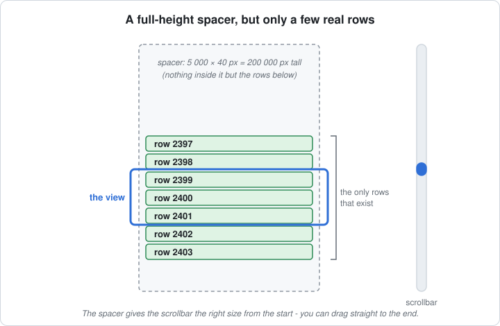
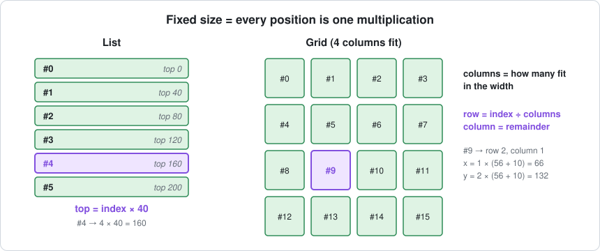
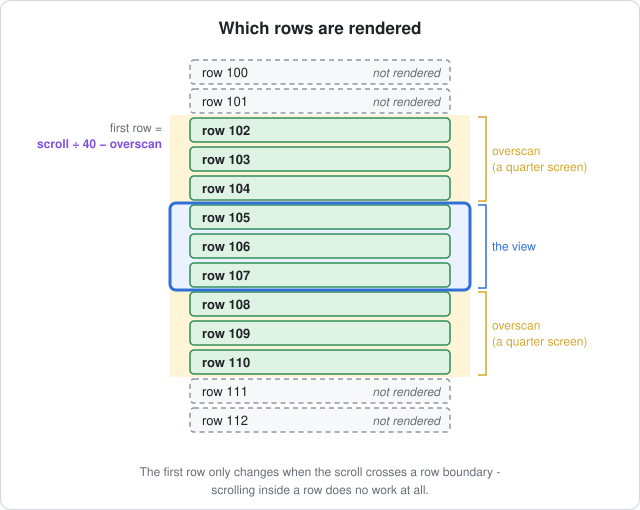
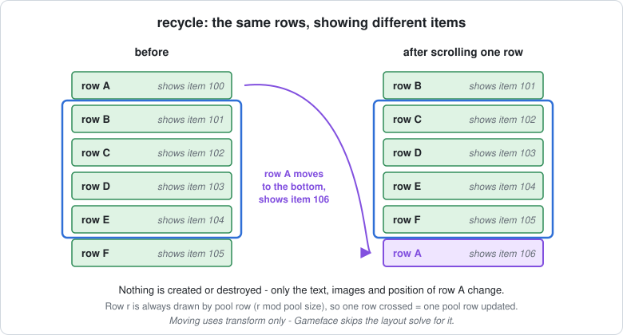
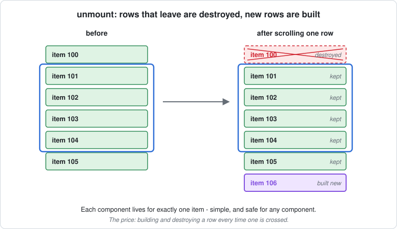
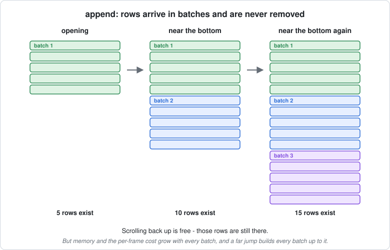
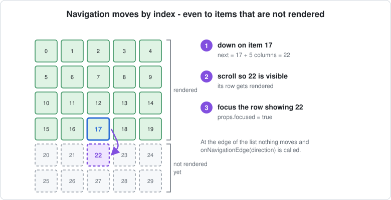
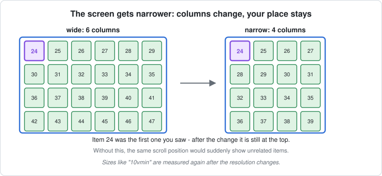

# VirtualScroll — how it works

How the `VirtualScroll` component (`src/components/Layout/VirtualScroll/`) shows thousands of items
while only a screenful of them exists.

← Back to the overview: [Long lists in Gameface UI](./README.md)

**Contents:**
[1. How to use it](#1-how-to-use-it) ·
[2. The spacer](#2-a-tall-spacer-and-a-few-real-rows) ·
[3. Same size](#3-every-item-has-the-same-size) ·
[4. Which rows](#4-which-rows-are-rendered) ·
[5. Modes](#5-the-three-modes) ·
[6. Navigation](#6-keyboard-and-gamepad) ·
[7. Resolution](#7-changing-the-resolution) ·
[8. Risks](#8-risks) ·
[9. Files](#9-where-things-are)

---

## In short

- A **tall empty spacer** gives the scrollbar the size of the full list.
- Only the **rows around the view** are real. Everything else doesn't exist.
- Every item has **the same size**, so any position is one multiplication.
- When you scroll, rows are **reused** (`recycle`), **rebuilt** (`unmount`) or **added in batches** (`append`).
- Result: 5 000 items scroll at 60 FPS with 624 elements, instead of 16 FPS with 40 000 ([all measurements](./README.md#5-measured)).

---

## 1. How to use it

**Give it the items, the size of one item, and how to draw one item.**

```tsx
import VirtualScroll, { createVirtualization, VirtualItemProps } from '@components/Layout/VirtualScroll/VirtualScroll';
```

### 1a. A simple list

**Props and a child function — enough for most lists.**

```tsx
<VirtualScroll items={players()} itemHeight={40} style={{ height: '400px' }}>
    {(player, index) => (
        <div class={styles.row}>
            <span>#{index() + 1}</span>
            <span>{player().name}</span>
        </div>
    )}
</VirtualScroll>
```

- `player` and `index` are **functions** — write `player().name`, not `player.name`.
- The list needs a **height** (on itself or its parent), like a normal `Scroll`.

### 1b. A list you control from code

**`createVirtualization` gives you an object to scroll the list and read what's on screen.**

```tsx
const Row = (props: VirtualItemProps<Player>) => (
    <div class={styles.row}>#{props.index + 1} {props.item.name}</div>
);

const Leaderboard = () => {
    const board = createVirtualization({ items: () => store.players, component: Row, itemHeight: 40 });

    return (
        <>
            <span>Showing {board.visibleRange().start + 1}-{board.visibleRange().end}</span>
            <button onClick={() => board.scrollToItem((p) => p.id === myId, 'center')}>Find me</button>
            <VirtualScroll virtualization={board} style={{ height: '60vh' }} />
        </>
    );
};
```

- The item component gets normal props: `props.item`, `props.index`, `props.focused` (no `()` needed).
- Pass `items` as a function (`() => store.players`) so the list follows a signal or store.

### 1c. A grid with gamepad navigation

**Add `itemWidth` for a grid, and `navigation` for keyboard / gamepad.**

```tsx
const inventory = createVirtualization({
    items: () => store.inventory,
    component: Slot,                 // highlight it with props.focused
    itemWidth: '10vmin',             // CSS lengths scale with the resolution
    itemHeight: '10vmin',
    gap: '1vmin',
    align: 'center',                 // 'start' | 'center' | 'stretch'
});

<Navigation>
    <VirtualScroll virtualization={inventory} navigation="inventory" style={{ height: '60vh' }} />
</Navigation>
```

### 1d. Picking a mode and the extras

**Everything else is one prop (or one option in `createVirtualization`).**

| You need | Add | Example |
| --- | --- | --- |
| Rows with checkboxes, toggles, inputs | `mode="unmount"` | friends list with toggles |
| A short feed read from top to bottom | `mode="append"` (`batchSize`, default 5 rows) | notifications |
| Stay at the bottom when new items arrive | `stickToEnd` | kill feed |
| Load more near the end | `onEndReached={load}` (`endThreshold`, default 2 rows) | server browser |
| Something to show while empty | `fallback={<Empty />}` | "Searching…" |
| Know what's rendered (e.g. to preload icons) | `onRangeChange={(range) => …}` | icon preloading |
| Leave the list with the D-pad | `onNavigationEdge={(direction) => …}` | grid → equipment panel |
| More or less buffer around the view | `overscan` (rows, or a CSS length) | very fast scrolling |
| A bigger scrollbar handle | `minHandleSize` (default 24 px) | very long lists |

### 1e. Controlling it from code

**The object from `createVirtualization` — works even for items that aren't rendered.**

| Call | Does |
| --- | --- |
| `scrollToIndex(i, align?)` | Scrolls to an item. `align`: `'nearest'` (default), `'start'`, `'center'`, `'end'`. |
| `scrollToItem(find, align?)` | Finds the first matching item and scrolls to it. |
| `scrollToOffset(px)` | Scrolls to a pixel position from the top. |
| `focusIndex(i)` | Scrolls to an item and gives it the navigation focus. |
| `visibleRange()` | `{ start, end }` of the fully visible items. |
| `renderedRange()` | `{ start, end }` of the rendered items (visible + buffer). |
| `focusedIndex()` | The focused item, or `-1`. |
| `columns()` | The current number of columns (`1` for a list). |

- They can be called before the list is on screen — the last request runs once it's ready.
- More examples (leaderboard, inventory, chat, server browser) with live previews: the public docs page
  `docs/src/content/docs/components/Layout/virtual-scroll.mdx`.

---

## 2. A tall spacer and a few real rows

**The scrollbar sees the full list. Gameface only sees a few rows.**



- The **spacer** is an empty element exactly as tall as the whole list would be — so the scrollbar has
  the right size from the start and can be dragged straight to the end.
- The **rows** sit inside the spacer, positioned with `transform: translate(x, y)` — the cheapest change
  in Gameface, no layout solve.
- Their container uses Gameface's `display: simple`, which skips the layout solve for its children.

---

## 3. Every item has the same size

**To place row 2 400 without building the 2 399 before it, its position must be calculable.**



- **List:** `top = index × item height`.
- **Grid** (set `itemWidth`): columns = how many fit in the width; `row = index ÷ columns`,
  `column = the remainder`; multiply both by the cell size plus the gap.
- The same math answers "which item is at this scroll position?" and gives the spacer its height.
- Sizes can be pixels or CSS lengths (`'10vmin'`). CSS lengths are measured from a hidden element,
  2 frames after mounting — Gameface lays out a couple of frames after a change.

---

## 4. Which rows are rendered

**The rows in the view, plus a buffer above and below.**



- The buffer (*overscan*) is a quarter of the view by default, at least one row. It's ready before it
  scrolls in, so the player never sees empty space.
- First rendered row = `scroll position ÷ row height − overscan`. It only changes when the scroll
  **crosses a row boundary** — scrolling inside a row does no work at all.
- Near the end of the list the window stops moving, so the number of rows stays constant.

---

## 5. The three modes

**What happens when a row leaves the view and a new one enters.**

| | `recycle` (default) | `unmount` | `append` |
| --- | --- | --- | --- |
| Rows that exist | a fixed pool | the window | everything loaded |
| Per row scrolled past | update one row's content | destroy one row, build one row | nothing (or a batch) |
| Memory | small, constant | small, constant | grows |
| Jump far away | cheap | cheap | builds everything up to there |
| Item components | must read the item reactively | anything | anything |
| Use for | rows that **show** data | rows with **stateful** components | short feeds read top to bottom |

### 5a. `recycle` — reuse the same rows

**Rows are never created or destroyed while scrolling — the row that leaves becomes the row that enters.**



- A **pool** of rows covers the view and the buffer. It is created once.
- List row `r` is always drawn by pool row `r mod pool size` — so scrolling one row frees exactly the
  pool row the new row needs.
- On reuse, only the parts that read the item change (text, images, colors) plus one `transform`.
- A far jump (`scrollToIndex(4000)`) updates every pool row at once, but still creates nothing.

**The one rule** — because a row shows different items over time, read the item **inside JSX** (or an
effect / memo), never copy it once:

```tsx
// ❌ keeps showing the first item this row was created for
const Slot = (props: VirtualItemProps<Item>) => {
    const [count] = createSignal(props.item.count);
    return <div>{count()}</div>;
};

// ✅ updates every time the row shows another item
const Slot = (props: VirtualItemProps<Item>) => <div>{props.item.count}</div>;
```

State that lives *inside* a row (hover, open panel, running animation) belongs to the row, not the
item — keep it in data, or reset it when `props.index` changes. Library components that copy props
once (`Checkbox`, `ToggleButton`, `TextSlider`, `Tabs`, `Pagination`, `RadialMenu`) need `unmount`.

### 5b. `unmount` — build new rows, destroy old ones

**Each row belongs to one item for its whole life.**



- **Good:** works with any component; `onMount` / `onCleanup` run once per item.
- **Cost:** one row destroyed and one built per row crossed — about 2× the script time of `recycle`,
  and it starts dropping frames when scrolling fast.
- **Memory:** the same as `recycle`.

### 5c. `append` — load in batches, keep everything

**Rows are added in batches near the bottom and never removed.**



- A batch is 5 rows by default (`batchSize`). The spacer still has the full height.
- **Good:** opens fast; scrolling back over loaded rows costs nothing.
- **Cost:** memory and per-frame work grow with every batch — after a long scroll it behaves like a
  normal `Scroll`. Each batch is a small spike.
- A **far jump** builds every batch up to that point at once.

---

## 6. Keyboard and gamepad

**Navigation moves by index — so it can reach items that don't exist yet.**



- Enable it with the `navigation` prop inside a `Navigation`.
- **Up / down** = `± columns`, **left / right** = `± 1` inside a row.
- While focus is inside the list, spatial navigation is paused — on its own it would wrap from the last
  rendered row to the first *rendered* row, which isn't the top of the list.
- **Focus follows the item:** if the player scrolls the focused item away (wheel, right stick), the focus
  moves to the nearest visible item.
- **At the edge** nothing moves and `onNavigationEdge(direction)` is called.

---

## 7. Changing the resolution

**Columns change, the player keeps looking at the same items.**



- On a window or container resize, CSS sizes (`'10vmin'`) are measured again and the columns
  recalculated.
- The first visible item — or the focused one — is kept in place. Without this, the same scroll
  position would show completely different items.

---

## 8. Risks

The full list, with fixes, is in the overview: [Risks](./README.md#4-risks). Specific to VirtualScroll:

- **`recycle`** — state, animations and transitions **carry over** to the next item; element ≠ item.
- **`unmount`** — animations **restart** and state is **lost** when an item scrolls away.
- **`append`** — **slows down** the longer the player scrolls.
- **All modes** — off-screen items have no element; items must be the same size; DOM order isn't list
  order (`:nth-child` doesn't work).

---

## 9. Where things are

| File | What's in it |
| --- | --- |
| `src/components/Layout/VirtualScroll/VirtualScroll.tsx` | The component: window, modes, navigation, resizing |
| `src/components/Layout/VirtualScroll/layout.ts` | The math: columns, positions, which rows to render |
| `src/components/Layout/VirtualScroll/createVirtualization.ts` | `createVirtualization` and its methods (`scrollToIndex`, `focusIndex`, …) |
| `docs/src/content/docs/components/Layout/virtual-scroll.mdx` | Public docs with examples |
| `design-docs/virtual-scroll.md` | Specification and all measurements |
| `VirtualScrollBench.tsx` (this folder) | The bench |
| `virtual-scroll-images/` (this folder) | The pictures in this document |
